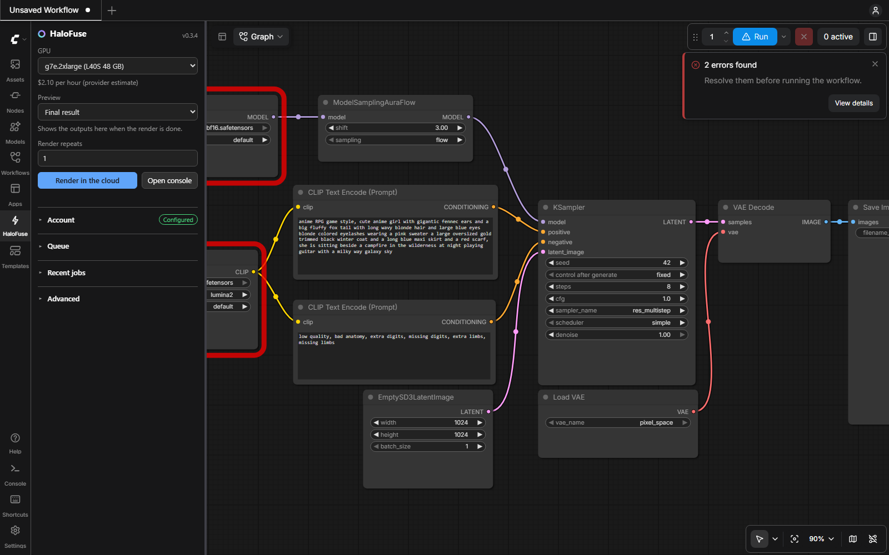
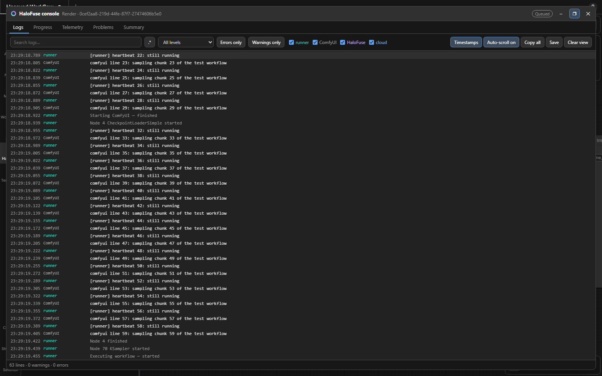
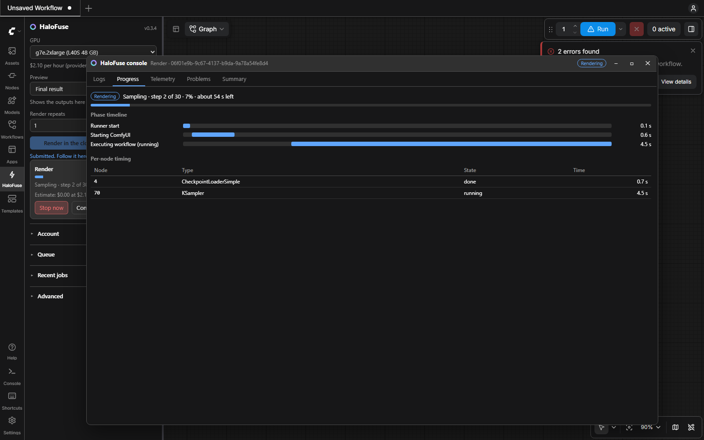
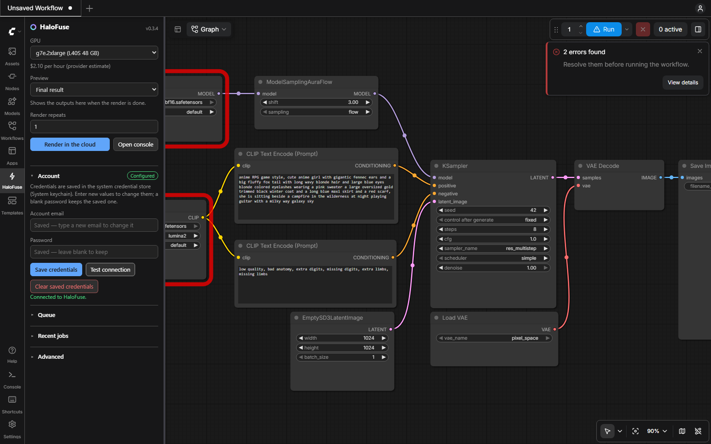
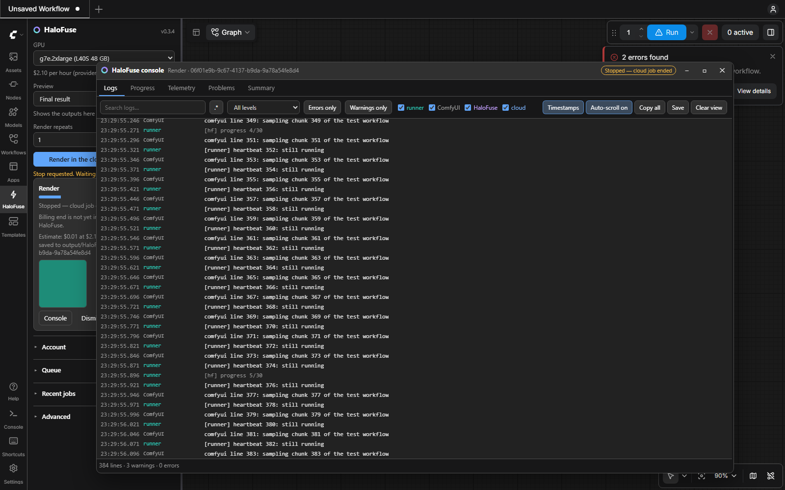

# HaloFuse for ComfyUI

**Render the workflow you have open in ComfyUI on a cloud GPU, follow it live, and get the results back in your
output folder.** HaloFuse is a ComfyUI extension (a sidebar panel and a floating console), not a graph node: you keep
authoring locally and the cloud does the heavy lifting.



> **Release status: 0.4.0, in development.** This README separates what is in the code today from what is still being
> built. Screenshots were taken on an isolated test machine (ComfyUI 0.39.0, frontend 1.53.10) against a
> **simulated** cloud backend. Nothing that needs a real cloud GPU (how fast a stop ends billing, live previews from a
> real render, actual cost, GPU memory figures) has been verified yet.

## What you get

| | Status |
|---|---|
| **One-click cloud render** of the open workflow; GPU list with an hourly estimate; render repeats (fresh seed each time) | available |
| **Account section**: password kept in the system keychain, never shown again; blank save keeps it; Test connection; no address field | available |
| **Floating console**: move, resize, near-full-screen, minimise; search, filters, copy all, save; restored after a reload or a ComfyUI restart | available |
| **Job records on disk** in `output/HaloFuse/<job id>/` (record, workflow, logs) | available |
| **Stop now / Stop after current** with every cancellation step shown; maximum runtime per job; cost estimate | available |
| **Render queue** on one warm cloud machine: reorder, remove, pause, resume; survives a restart | available |
| **Plain-language diagnosis** of a failed render with a next step | available |
| Pre-render **model check** with consented upload of missing models | available |
| Progress timeline, per-node timing, GPU telemetry, OOM recovery, launch presets | needs the 0.4.0 runtime image ([why](#the-cloud-runtime)) |
| Live view of a cloud render (step frames, masks as overlays, results), per-render step preview Off / Fast / Detailed, **Stop now** and **Stop and try a new seed** from the preview (experimental) | needs the new runtime image (with live preview); not verified on a real cloud render ([manual 6.1](docs/manual.md)) |
| **Automatic delivery of every output** (video, audio, EXR, masks, nested folders) into `output/HaloFuse/<job id>/outputs/`, size + SHA-256 checked, resumable, with **Retry** and **Recover outputs** | available (partial outputs after a stop need the runtime image) |
| **Workflow Check** (nodes, models, input files, values, GPU memory; no GPU started) and **Quick Draft** (a reduced copy; your graph is never changed) | available (checked against a recorded node list until a runtime image publishes its own) |
| **Node profiles** and the optimised runtime build | in development |

<table>
<tr>
<td width="50%"><br><sub>Floating console, Logs tab: search, levels, sources, copy and save.</sub></td>
<td width="50%"><br><sub>Progress tab: phase timeline and per-node timing (needs the 0.4.0 runtime image).</sub></td>
</tr>
<tr>
<td width="50%"><br><sub>Account: keychain storage, masked password, Test connection.</sub></td>
<td width="50%"><br><sub>Stop now: the state moves from requested to accepted to "stopped, cloud job ended".</sub></td>
</tr>
</table>

## Install

1. Clone into ComfyUI's `custom_nodes` folder (a git clone creates `custom_nodes/ComfyUI-HaloFuse`; ComfyUI Manager
   creates the same folder):
   ```
   cd ComfyUI/custom_nodes
   git clone https://github.com/Code2Collapse/ComfyUI-HaloFuse
   ```
2. Install the dependencies into **the same Python that runs ComfyUI**:
   ```
   python -m pip install -r ComfyUI-HaloFuse/requirements.txt
   ```
   Portable ComfyUI (embedded Python in `python_embeded`): if pip stops with `Cannot import 'hatchling.build'`, run
   from the `python_embeded` folder:
   ```
   .\python.exe -m pip install hatchling
   .\python.exe -m pip install --no-build-isolation -r "..\ComfyUI\custom_nodes\ComfyUI-HaloFuse\requirements.txt"
   ```
3. Restart ComfyUI. A **HaloFuse** tab appears in the left sidebar. Prefer a floating panel? Set **Settings >
   HaloFuse > Panel location** to *Floating window* (a movable panel opened from a draggable bolt button) or *Both*.

You need ComfyUI on Python 3.12 or newer and a HaloFuse account (email and password) from your HaloFuse
administrator. The cloud service itself is configured by the administrator; there is nothing to enter about it.

## Quick start

1. Open the **HaloFuse** tab. In **Account**, enter your email and password, **Save credentials**, then
   **Test connection**.
2. In **Advanced**, set the **cloud model library path** (the folder that holds your model subfolders, for example
   `/comfy-models`) and save.
3. Pick a GPU, open a workflow that ends in a save node, and click **Render in the cloud**.
4. Click **Open console** to follow the log. When the render ends, the result appears in the panel and in ComfyUI's
   output folder.

## Documentation

| Document | For |
|---|---|
| [User manual](docs/manual.md) ([PDF](docs/manual.pdf)) | every feature, with its status |
| [Troubleshooting and operations runbook](docs/runbook.md) | failure categories, log locations, recovery, known limitations |
| [Getting started guide](runtime/USER-GUIDE.md) | first-time setup from a bare machine |
| [Cloud runtime](runtime/README.md) | maintainers of the cloud ComfyUI image |
| [Changelog](CHANGELOG.md) | what changed |

## Repository layout

```
ComfyUI-HaloFuse/            the ComfyUI extension (this folder is what ComfyUI loads)
├── __init__.py              registers the HaloFuse routes; no graph nodes
├── halofuse_bridge/       server side: account, jobs, queue, console data, diagnosis (internal package name)
├── web/                     the panel and the floating console
├── docs/                    manual, runbook, screenshots
└── runtime/                 the cloud runtime: Docker image, runner, catalogue (not loaded by ComfyUI)
```

## The cloud runtime

Renders run on a ComfyUI runtime image in the cloud ([runtime/](runtime/README.md)). The 0.4.0 runner in `runtime/`
adds structured progress events, telemetry, previews, launch presets, automatic recovery from out-of-memory errors
and crashes, clean stops, and outputs that keep their subfolders. The extension already understands all of it, but
the cloud uses a runtime image only after it has been built and published, and the 0.4.0 image has **not been built
yet**. Until then renders run on the previous image: they work, but the console shows the plain log without the
progress timeline and telemetry, and those features stay inactive.

## Security and privacy

- The cloud service address and your password never reach the browser; no request returns them, and they are never
  written into workflows or job folders. Logs and error messages are scrubbed of passwords, tokens and service
  addresses.
- Account and settings requests are accepted only from this computer, and every request that changes something must
  come from the HaloFuse panel (a cross-site page cannot submit it).
- HaloFuse's connector runs inside your ComfyUI process. A person with administrator access to the computer, or able
  to inspect its network traffic, can still discover the service it talks to; see the runbook's known limitations.
- Do not run ComfyUI with `--listen` on an untrusted network; ComfyUI itself has no login.

## For developers

The automated test suites (extension and runtime, no GPU / Docker / cloud account needed) are maintained in the
development repository and are not part of this distribution. CI here validates the catalogue, lints the
Dockerfile and builds the runtime image.

## Licence

AGPL-3.0, see [LICENSE](LICENSE). HaloFuse is built on an MIT-licensed bridge and runtime; that notice is kept
in [LICENSE-MIT](LICENSE-MIT) and [NOTICE](NOTICE).

## What changed on 2026-11-23

- Workflow Check reads core Math Expression inputs correctly and skips nodes that feed no output, as ComfyUI does.
- Node availability is checked against the cloud image's own node list (shipped with the extension).
- The sidebar panel scrolls.
- Models are found anywhere in the cloud library by name and size, and missing models upload by themselves (same
  folders as on this computer; switch off under Advanced). Details: CHANGELOG.md.
- Later the same day: the console always shows the last job and every failure (new Activity tab), the floating
  window opens when chosen, and Workflow Check reads input files the way ComfyUI does.
- Advanced > Cloud runtime: Original image (default) or HaloFuse image (the newer node packs); the Workflow Check
  follows the choice.
