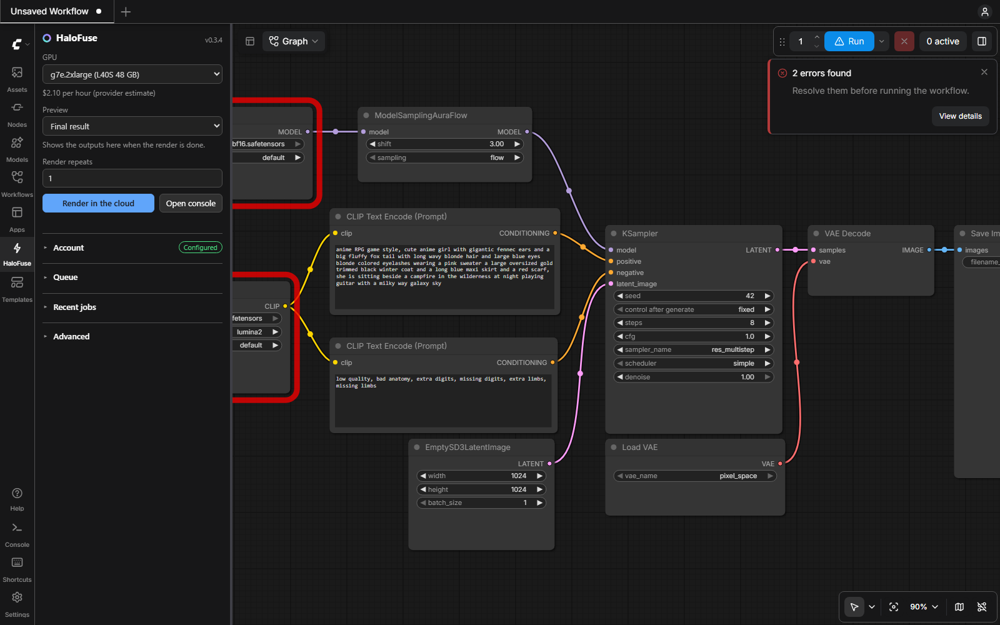
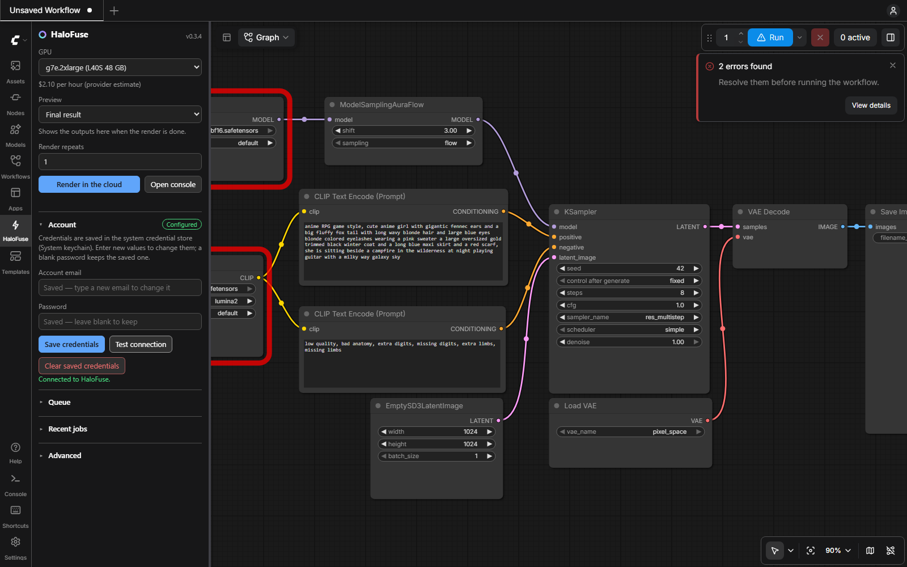
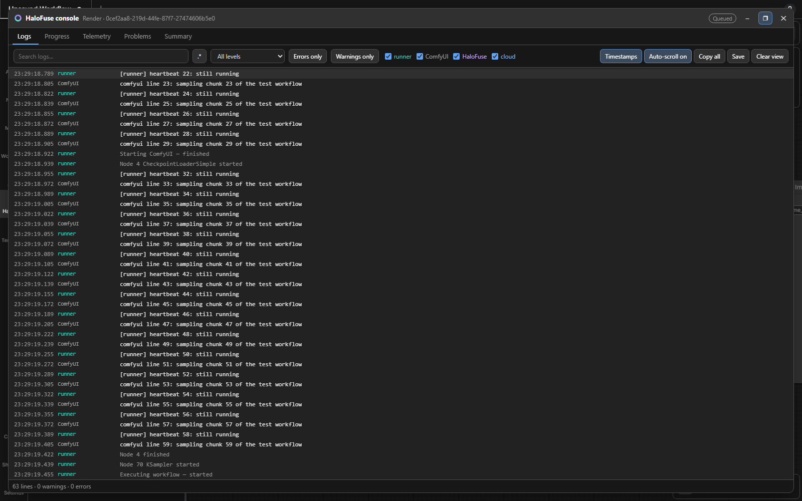
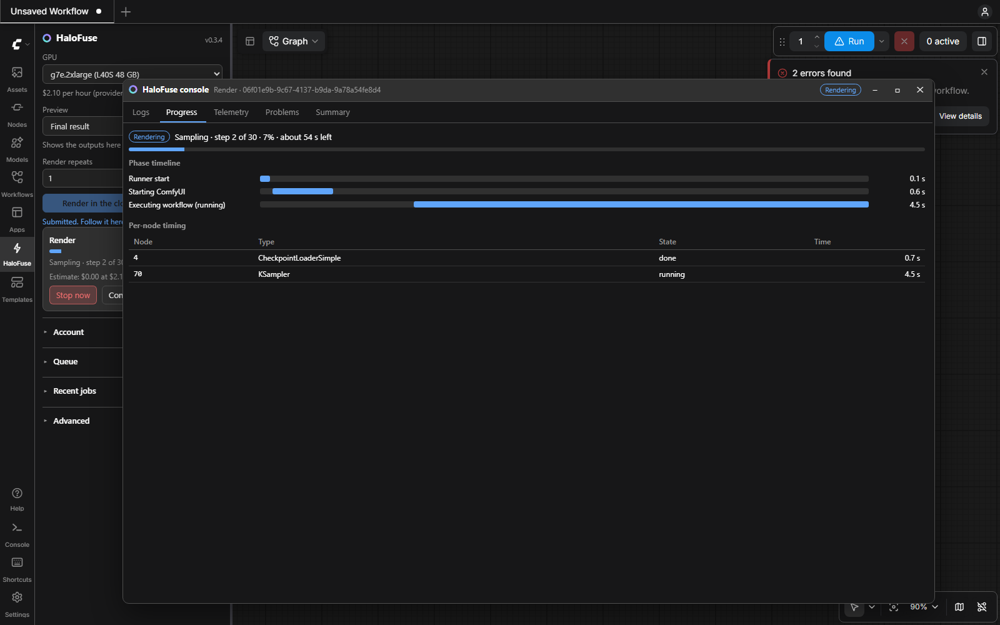
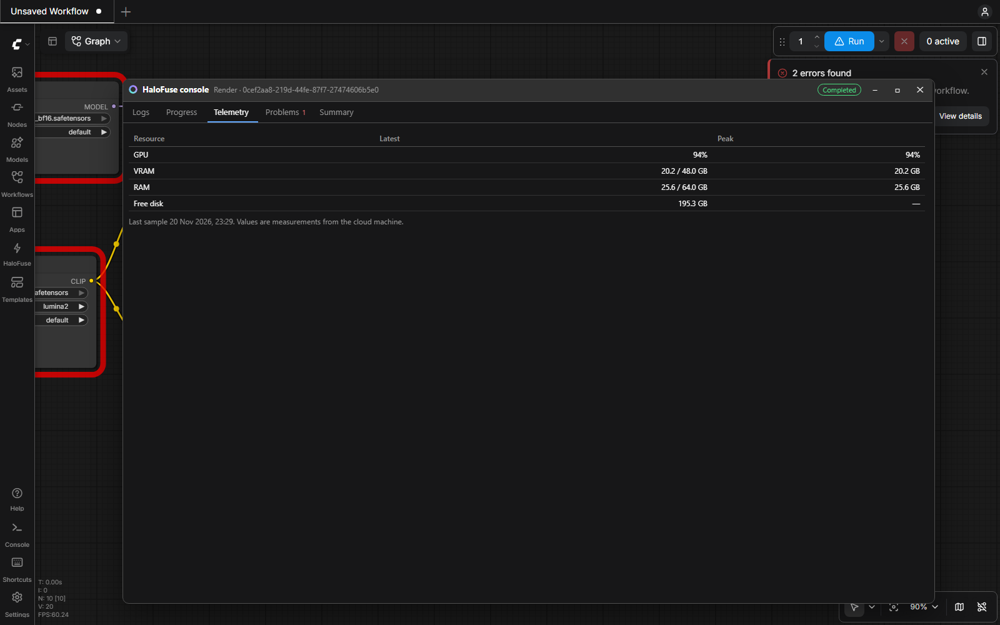
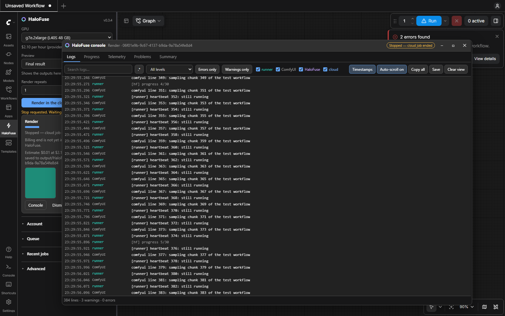

# HaloFuse for ComfyUI — User Manual

**Version 0.5.0 · November 2026**

HaloFuse renders the workflow you have open in ComfyUI on a cloud GPU, lets you follow it live, and brings the
results back into ComfyUI. You keep authoring locally; the cloud does the heavy lifting.

**How to read this manual.** Every feature carries one of these labels:

| Label | Meaning |
|---|---|
| **Available** | In the code of this release and covered by automated tests. The screenshots come from an isolated test machine with a *simulated* cloud backend. |
| **Needs the 0.4.0 runtime image** | The extension supports it, but it also needs the new cloud runtime, which has not been built and published yet (section 11). Until then the feature stays inactive. |
| **In development** | Not part of the code yet. The text describes the intended behaviour. |
| **Experimental** | Off by default and labelled in the panel. |

Anything that depends on a real cloud GPU (how fast a stop ends billing, live previews from a real render, actual
cost, GPU memory figures) is **not verified** for 0.4.0 until it has been run on real hardware.

---

## 1. When HaloFuse makes sense

Every cloud render pays a start-up cost (machine start, runtime image, model load) before the first sampling step,
so a fast local GPU beats the cloud on models that fit in your VRAM. HaloFuse earns its keep when:

- **Your models exceed your local VRAM.** Run checkpoints and text encoders your card cannot hold, on a GPU class
  you do not own.
- **You have long queues.** Queue the work and keep using (or switch off) your workstation; the warm-machine queue
  spreads the start-up cost over many renders.
- **You have no GPU, or a small one.** Author anywhere ComfyUI runs and let the cloud render.

## 2. How it works

HaloFuse is an extension, not a graph node. When you render, it sends your current graph (ComfyUI API format) and
the input files it references (for example a LoadImage picture) to the HaloFuse cloud, which runs it on a ComfyUI
runtime image on a cloud GPU. Your models live in your **cloud model library**: you stage them once, and the cloud
machine reads them from there (lazily, cached between jobs).

```
Your ComfyUI (authoring)                   HaloFuse cloud GPU
  Render in the cloud  ───────────────►  workflow + referenced input files
  panel and console  ◄─────────────────  progress and log stream
                                          models read from your cloud model library (cached)
  output folder  ◄─────────────────────  results and logs
```

Terms used in this manual:

| Term | Meaning |
|---|---|
| **Render** | one request to run a workflow in the cloud, from submit to results |
| **Job id** | HaloFuse's id for a render; it names the render's folder on your disk |
| **Render repeats** | how many times one render runs the same workflow, with a fresh seed each time |
| **Queue** | several workflows run back to back on one warm cloud machine |
| **Warm machine** | a cloud machine kept ready for a queue; billed while it is held |
| **Cloud model library** | your model folder in HaloFuse cloud storage; it mirrors your local `models` folder |
| **Runtime image** | the ComfyUI installation the cloud machine runs |

## 3. Install

**Available.**

1. Clone into ComfyUI's `custom_nodes` folder (this creates `custom_nodes/ComfyUI-HaloFuse`; ComfyUI Manager creates
   the same folder):

   ```
   cd ComfyUI/custom_nodes
   git clone https://github.com/Code2Collapse/ComfyUI-HaloFuse
   ```

2. Install the dependencies into the **same Python that runs ComfyUI**:

   ```
   python -m pip install -r ComfyUI-HaloFuse/requirements.txt
   ```

   Portable or desktop ComfyUI (embedded Python in a `python_embeded` folder). If pip stops with
   `Cannot import 'hatchling.build'`, install the build backend first and skip build isolation. From the
   `python_embeded` folder:

   ```
   .\python.exe -m pip install hatchling
   .\python.exe -m pip install --no-build-isolation -r "..\ComfyUI\custom_nodes\ComfyUI-HaloFuse\requirements.txt"
   ```

3. Restart ComfyUI. A **HaloFuse** tab appears in the left sidebar.

The `runtime/` folder inside the extension is the cloud runtime's source; ComfyUI does not load it and you do not
need Docker.

## 4. Your cloud model library

**Available.** HaloFuse reads models from your cloud model library, so you upload each model once and reuse it on
every render. Lay the library out to **mirror your local ComfyUI `models` folder**, including subfolders:

```
<your library folder>/
├── diffusion_models/     e.g. FLUX2/flux2-dev.safetensors
├── text_encoders/
├── vae/
├── checkpoints/
├── loras/
└── controlnet/
```

A workflow refers to a model by its path, so a model in a subfolder locally must be in the same subfolder in the
library. Windows `\` separators are converted for you. Enter the library folder (for example `/comfy-models`) as the
**cloud model library path** under **Advanced**; it must start with `/`.

You can fill the library two ways: let HaloFuse upload models for you before a render (section 8), or use the
storage tools your HaloFuse administrator provides (best for very large files).

**See what is in it.** Open **Cloud model library** in the panel. HaloFuse lists the library once when you open the
section (and again when you press **Refresh**), next to the models on this computer:

| Status | Meaning |
|---|---|
| In the cloud · checksum verified | the cloud copy matches yours byte for byte (HaloFuse uploaded it and your file is unchanged) |
| In the cloud · same size | a cloud copy with the same name and size; HaloFuse did not upload it, so only the size is compared |
| Cloud only | in the library, not on this computer |
| Only on this computer | a render that uses it will offer to upload it first (section 8) |
| Differs from your copy | same name, different size: a render would use the cloud copy, not yours |

Use **Find a model** and the filter to narrow the list. Models stored more than once in the library are counted at the
bottom with the space they take. The list is read-only: deleting library files is not offered.

## 5. The panel

**Available.** Open the **HaloFuse** tab in ComfyUI's left sidebar.

**Where the panel shows.** ComfyUI **Settings > HaloFuse > Panel location** chooses where the panel lives. The change
applies at once, without a reload:

| Panel location | What you see |
|---|---|
| Sidebar (default) | the **HaloFuse** tab in the left sidebar |
| Floating window | no sidebar tab; the panel opens in its own window as soon as you choose this, and a round bolt button at the right edge of the canvas shows or hides it. Move the window by its title bar and resize it from any edge. Drag the button itself to put it anywhere |
| Both | the sidebar tab and the bolt button |

The bolt button shows a small blue dot while a render is running. The window's size and position, whether it was
open, and the button's position are remembered by this browser only; a window or button saved on another (larger)
screen comes back fully on this one. The command **HaloFuse: Show or hide the floating panel** (command
palette) works in every mode.



| Control | What it does |
|---|---|
| **GPU** | the cloud machine type, with its GPU memory and an hourly price estimate |
| **Preview** | Final result (default), No preview, Workflow check, Quick draft, Live preview (section 7.2) |
| **Render repeats** | renders per job, 1 to 100 (section 7.3) |
| **Render in the cloud** | checks your models, then submits the open workflow |
| **Open console** | the floating console (section 6) |
| **Account** | email and password (section 5.1) |
| **Queue** | several workflows back to back (section 7.4) |
| **Recent jobs** | this computer's HaloFuse jobs; open one in the console |
| **Advanced** | cloud model library path, image affinity, upload guard, automatic uploads, cloud runtime |

While a render runs, the panel shows its state, a cost estimate, **Stop now**, and a button to open it in the
console.

### 5.1 Account

**Available.**



- Enter your email and password and click **Save credentials**. The password goes into your operating system's
  keychain (Windows Credential Manager, macOS Keychain, or the Linux Secret Service). The field is cleared after
  saving and the password is never shown again; the panel shows **Configured**.
- Leaving the password blank when you save keeps the stored one. **Test connection** tells you whether sign-in
  worked, failed, or the service could not be reached. **Clear saved credentials** removes them.
- If this computer has no keychain, HaloFuse does **not** silently store the password in plain text. It offers
  **Store as plain text on this computer**; the panel then says the password is stored unencrypted.
- A password saved by an older version is moved into the keychain automatically on first start; it is removed from
  the old settings file only after the keychain copy has been verified. An older version run afterwards finds no
  password, so enter it there again.
- On managed computers the account can come from the deployment; the panel then shows it as managed and read-only.
- There is no field for the cloud service address. Your HaloFuse administrator configures it, and it is never sent
  to the browser. If it is missing, the panel says HaloFuse is not configured on this computer.

### 5.2 GPU selection

**Available.** Only GPU machine types are listed, grouped by family and size, each with its GPU memory and an hourly
price estimate. Choose the smallest GPU whose memory fits your models; a larger one helps only if the render needs
the memory or you want the fastest single render.

### 5.3 Settings reference

These are saved in the HaloFuse settings file in ComfyUI's `user` folder (a system folder the web UI cannot read).
They survive extension updates and reinstalls.

| Setting | Default | Meaning | Where |
|---|---|---|---|
| GPU | a mid-size GPU type | the cloud machine type | panel |
| Preview | Final result | section 7.2 | panel |
| Render repeats | 1 | renders per job, 1 to 100 | panel |
| Cloud model library path | `/models` | your library folder (section 4) | Advanced |
| Image affinity | Required | wait for a cloud machine that already holds the runtime image (faster start) or start sooner | Advanced |
| Upload guard (GB) | 50 | largest single model HaloFuse uploads for you | Advanced |
| Download missing models automatically | on | a model missing here and in the cloud library is downloaded from a public source, then uploaded (section 8) | Advanced |
| Ask before downloading models larger than (GB) | 20 | larger models ask first; 0 = never ask | Advanced |
| Hugging Face token | none | only for gated Hugging Face models; kept in this computer's keychain (or `HF_TOKEN`) | Advanced |
| Cloud runtime | Original image | *Original image*: the node packs the cloud has always had. *HaloFuse image*: those plus the newer node packs (newer KJNodes, DepthAnythingV2 and many more); first renders on it are not yet verified. The Workflow Check checks nodes against the runtime chosen here. | Advanced |
| Maximum runtime per job | 6 hours | a longer render is stopped and marked "timed out" | settings file; panel control in development |
| Maximum cost per job, daily cost cap | off | stop or block renders above an **estimated** cost | settings file; panel control in development |
| Launch preset | Safe | section 7.6 | settings file; panel control in development |
| Panel location | Sidebar | where the panel shows: Sidebar, Floating window or Both (section 5) | ComfyUI Settings > HaloFuse (saved by ComfyUI, not in the HaloFuse settings file) |
| Warm mode | Off | *Off*: nothing starts a warm machine by itself (Start in the panel still does). *Always Warm*: choosing it starts the machine; renders start it again after it shut down. *Smart Warm*: the machine starts only when you are about to render (the Workflow Check passed after Render, or models are being prepared for a render), so it provisions while models transfer; opening the panel never starts it. A settings file with the older *Keep the cloud machine warm* switched on means Always Warm | panel, warm machine |
| Warm duration | 1 hour | the machine shuts itself down after it has been idle (no render) this long: 30 min, 1, 2, 4, 8, 12 or 24 hours, or a custom 5 minutes to 7 days. The countdown pauses while renders or a queue run on it and starts again after the last one; keep-alive jobs never reset it; it survives a ComfyUI restart; a warning comes about 5 minutes before; **Keep it warm** starts it again. An automatic shutdown never stops a running render (the daily spending limit also waits for it) | panel, warm machine |
| GPU memory between workflows | Keep models loaded | *Keep models loaded*, *Unload when GPU memory is high* (at or above 90 %, again only after it fell below 75 %; both adjustable) or *Always unload between workflows* (the older *Also unload models* switch). Applies between the workflows of one cloud job (a queue batch); each separate render starts ComfyUI again anyway | panel, warm machine > Housekeeping |
| Downloads / uploads at a time | 2 / 2 | model transfers on this computer that run at the same time, 1 to 4 each; the same model is never transferred twice at once | panel, warm machine > Housekeeping |

## 6. The floating console

**Available.** **Open console** opens a large floating window that stays open when you close the panel.



- **Window.** Drag the title bar to move it, drag the corner to resize, use the buttons for near-full-screen,
  restore and minimise (a small pill restores it). Only the window position is remembered in the browser; never
  credentials or logs.
- **Logs tab.** The full job log, streamed continuously. Search (plain or regular expression), level filter,
  **Errors only**, **Warnings only**, source filters (runner, ComfyUI, HaloFuse, cloud), timestamps on or off,
  auto-scroll pause and resume, **Copy all**, **Save**, and **Clear view** (the log stored on disk is not touched).
  Runner and ComfyUI lines are styled differently. Click a line for its details. On the test machine the console
  kept up with 1,000 lines per second for 60 seconds without a slow frame, and searched 60,000 lines in under three
  seconds.
- **Reattach.** After a browser reload, or a ComfyUI restart, the console reattaches to a running job; when nothing
  runs, opening the console shows the last job. Either way the complete log is restored from disk. A render that
  failed while it was being submitted (for example a sign-in error) is opened in the console with its log.
- **Activity tab.** What the bridge refused or reported outside a job log, with the time: Workflow Check results (each
  blocking problem, warning and note on its own line), renders refused before a job existed, model upload failures,
  sign-in and GPU-list errors. Kept on this computer (the newest 1,000 entries). When there is no job yet, or a failure
  is newer than the job, the console opens on this tab. An empty tab says why it is empty.
- **Progress tab** (*needs the 0.4.0 runtime image*). Step and percentage of the running sampler, a phase timeline
  (for example runner start, ComfyUI start, executing the workflow) and per-node timing; click a node row to centre
  that node on the canvas.

  

- **Telemetry tab** (*needs the 0.4.0 runtime image*). GPU use, VRAM, system memory and free disk on the cloud
  machine, latest and peak. The screenshot shows simulated values.

  

- **Live tab** (*experimental; needs the HaloFuse cloud runtime, not the Original image*). See section 6.1. While a
  render runs, the console opens on this tab.
- **Problems tab.** Errors and warnings of the job, with the diagnosis (section 10).
- **Summary tab.** Status, HaloFuse job id, cloud job id, ComfyUI prompt ids, GPU, times, cost estimate and the
  outputs that reached your computer.

### 6.1 Live view: watch a cloud render and stop it early

**Experimental.** It needs the HaloFuse cloud runtime (Advanced > Cloud runtime; the Original image sends no live
previews) and has not yet been verified on a real cloud render. Choose **Live preview** before you render (section 7.2).

What you see while the render runs:

- **The current frame** of the sampler, large, with a thin step bar (`12/30`) on it. Under it: the node that is
  running, the step and an estimate of the time left (when the cloud runner can make a defensible one), which step
  preview is used (section 7.7), and how old the frame is (*Frame from 2 s ago*).
- **Masks and intermediate images.** Preview Image and mask preview nodes, and finished results (a video shows four
  of its frames in one picture), appear as small buttons as soon as their node finishes. Click a mask to see it over
  the image of the same render: **Overlay** (a tinted mask over the image), **Mask only** or **Image only**. A mask is
  never shown as a plain grey picture.
- **Recent frames.** A strip of the last 30 frames. Click one to hold it; **Back to live** resumes.
- **Honest gaps.** A preview is sent at most every 2 seconds and the cloud log can drop lines. When no new frame
  arrives for 6 seconds the frame dims and the line says *Waiting for the next preview (the cloud log can drop
  lines).* When the cloud reports dropped lines, the number is shown. A video render shows the first frame of the
  clip while it samples.

After the render ended (finished, failed or stopped):

- The line says *Render failed - showing the last frames.* (or *finished* / *stopped*) and the frame is marked
  *From the finished run*; its age no longer counts.
- Preview files that arrived with the outputs stay viewable: a video preview (for example from Video Combine) plays
  as a video, masks stay masks. A file that is no longer in the job folder shows *This preview file is no longer in
  the job folder.* instead of a broken picture.
- With no step frame at all the stage says why: *This render ended before any sampler ran.*, *The sampler (node 1458
  KSampler) stopped before its first step preview.* (for example when it ran out of memory), or *Node … sent no step
  previews: the cloud image has no preview decoder for this model.* When the detailed preview decoder for a model
  could not be loaded in the cloud, the line names it.
- The note *Live preview needs the HaloFuse cloud runtime* appears only when the render used the Original cloud image,
  which sends no live previews.

When it looks wrong:

- **Stop now** stops the cloud job (the same stop as in section 7.5); the button says *Stopping…* until the cloud
  answers.
- **Stop and try a new seed** stops the job and starts the same workflow again on the same GPU with the same preview
  settings, with new values only for seed inputs: inputs ComfyUI itself marks as seeds (they have a
  *control after generate* setting) and that hold a number, not a link. Nothing else is changed. The panel lists
  every change (*Node 3 (KSampler) seed 1234 → 98765*). If no seed can be changed safely, nothing is stopped and
  the panel says *No seed in this workflow can be changed safely. Change it in the graph and render again.*

The panel's job card shows the same current frame with its step bar, and both buttons.

Where previews go: the frames are written into `output/HaloFuse/<job id>/previews/` while the job runs (at most 300
files per job; when the job ends the last 24 frames, the newest frame of every node and every mask, intermediate and
result picture are kept). The job log keeps only a small record of each preview, never the picture itself.

## 7. Rendering

### 7.1 Render

**Available.**

1. Build or open a workflow as usual, ending in a save node (Save Image, a video combine node, Save Audio, ...).
2. Choose a GPU and click **Render in the cloud**.
3. HaloFuse checks your models against the cloud model library (section 8), then submits. Follow the render in the
   panel or the console. When it ends, every output it saved is downloaded into `output/HaloFuse/<job id>/outputs/` (section 9) and the
   first image is shown in the panel.

Each seed's **control_after_generate** setting (`fixed`, `increment`, `decrement`, `randomize`) is honoured, as
ComfyUI does locally.

**Supported workflows.** Any ComfyUI workflow whose nodes exist in the cloud runtime image: image, video, audio and
multi-output workflows. No model family is assumed. A workflow that needs a custom node the runtime image does not
contain is rejected by the cloud ComfyUI, and the diagnosis names the missing node. (Workflow Check
finds this before a GPU starts.)

### 7.2 Preview modes

| Mode | What it does | Status |
|---|---|---|
| **Final result** (default) | the normal render; results appear when it is done | available |
| **No preview** | renders without previews in the panel; outputs are still saved | available |
| **Workflow check** | checks nodes, models, input files and values against the cloud runtime; no GPU is started and nothing is billed | available; packs not in the recorded node list are reported as *not verified*, never as missing |
| **Quick draft** | renders a reduced copy (smaller size, fewer steps or frames); your graph is never changed and the draft workflow can be inspected | available; sizes, steps, batch and frame counts stay on each widget's own step grid (e.g. Wan 4n+1 lengths) |
| **Live preview** | shows the render while it runs: step frames, masks, intermediate images and results, with **Stop now** and **Stop and try a new seed** (section 6.1); choose the step preview below the mode (section 7.7) | **experimental**, needs the new HaloFuse runtime image (with live preview), not verified on a real cloud render |

### 7.3 Render repeats

**Available.** Set **Render repeats** to render several results from one job. The job pays the start-up cost and
loads the model once, then runs the workflow that many times in sequence with fresh seeds. Memory use stays at one
render's worth, and every repeat after the first costs only its own sampling time. The count is 1 to 100.

### 7.4 Render queue

**Available.** The queue runs several different workflows back to back on one warm cloud machine. Workflows are sent
in chunks of up to 10 per cloud job, all on the same warm machine, so only the first pays the model load.

1. Open a workflow and click **Add open workflow**. Repeat for each workflow; each item keeps a snapshot of the graph
   as it was when you added it. Move items up or remove them before you start.
2. Click **Run queue**. HaloFuse checks the models of all queued workflows first (one consent list if anything needs
   uploading), prepares the warm machine and runs the chunks in turn. Each workflow shows queued, running,
   succeeded or failed. A failed workflow does not stop the others and never removes results that already finished.
3. While it runs: reorder or remove pending items, **Pause queue** / **Resume queue**, **Stop after current** (the
   running item finishes, then the queue stops) or **Stop now**.

The queue is saved on disk and survives a ComfyUI restart. The warm machine is billed for the whole session,
including gaps, so run queues back to back.

### 7.5 Stopping a render, limits and cost

**Available**; the cloud-side timing is **not verified**.



- **Stop now** asks the cloud to stop the job, and the panel shows each step: stop requested, accepted by the cloud,
  then *stopped, cloud job ended*. If the cloud never confirms, the panel says so and never shows the job as
  stopped. If the job finished just before the stop arrived, it is shown as completed. Asking several times sends
  one stop.
- **Maximum runtime** (6 hours by default) stops a render that runs too long; it is shown as *timed out*, never as
  failed or still running.
- **Cost** is an **estimate**: the hourly price times the billed time. The panel and the console summary show it.
  Optional per-job and daily caps use the same estimate.
- How quickly a stop ends billing on the cloud side has not been measured yet.
- **Stop and try a new seed** (live view and job card, section 6.1) stops the job and renders it again with new
  seed values only.

### 7.6 Launch presets

*Needs the 0.4.0 runtime image; panel control in development.* A preset sets how the cloud ComfyUI starts. Only
options from a fixed allowlist are accepted; anything else is rejected before the job starts.

| Preset | Effect |
|---|---|
| Safe (default) | stock ComfyUI settings |
| Fast | ComfyUI's `--fast` optimisations, which ComfyUI itself marks as untested and potentially lowering quality |
| Max Memory | keeps less in memory and enables safer retries after an out-of-memory error (for example a tiled VAE decode) |
| Debug | verbose ComfyUI logging, slower |

With the 0.4.0 runtime image the cloud runner also restarts ComfyUI once after a crash, so one failed workflow in a
queue chunk no longer stops the rest of the chunk.

### 7.7 Step preview (Off, Fast, Detailed)

**Experimental**, shown under **Preview** when Live preview is chosen. It sets how the cloud ComfyUI turns each
sampler step into a picture, for this render only:

| Choice | What you see | Needs |
|---|---|---|
| **Off** | no step frames; masks, intermediate images and results still arrive | nothing |
| **Fast** (default) | a blurry colour approximation of each step | nothing |
| **Detailed** | a picture close to the final image; may slow sampling slightly (not measured yet) | the small preview decoder files in your local `models/vae_approx` folder; HaloFuse uploads them to your cloud model library with your consent, like any model (section 8) |

**Detailed** is greyed out, with the reason, when `models/vae_approx` on this computer holds no decoder file. When
the cloud ComfyUI cannot use a decoder for the model in your workflow, the live view says *Detailed preview
unavailable for this model; showing the fast preview.* Frames are re-encoded in the cloud to at most 24 KB each.

## 8. Pre-render model check and upload

**Available.** Before anything is submitted, HaloFuse scans the workflow (or every queued workflow) for the models it
references (checkpoints, LoRAs, VAEs, text encoders, ControlNets, CLIP Vision, upscale models, GGUF files) and checks
each against the cloud model library by **file name and exact size**. Two rules:

- **Nothing is uploaded without your explicit consent.**
- **Nothing is submitted while a referenced model is missing.**

What the check can find:

- **Everything present.** The render submits immediately.
- **Missing in the library, present locally.** A consent list shows each model's name, folder and size: upload, then
  render; upload only (the render is cancelled and the upload continues in the background); or cancel.
- **Same name, different size.** Flagged as out of date; you can upload over the cloud copy or render with it.
- **Missing everywhere.** HaloFuse looks for a public download (see below). Found: the model is downloaded to this
  computer, uploaded, and the render starts. Not found: HaloFuse names the model, says what it searched and offers
  *Paste a download link*; when several different files have that name, it lists them for you to pick.
- **Already uploading.** The render waits for the transfer.

Background uploads keep running when the panel is closed or the browser tab reloads (the transfer runs in the
ComfyUI server). **Cancel upload** stops one. Uploads go to `{cloud model library path}/{model folder}/{name}`,
keeping local subfolders: `FLUX2\flux2-dev.safetensors` in your local `diffusion_models` folder goes to
`/comfy-models/diffusion_models/FLUX2/flux2-dev.safetensors`. Files above the upload guard (default 50 GB) are not
uploaded by HaloFuse; uploads are not resumable, so stage very large files with your administrator's storage tools.

**Getting missing models (available, owner 2026-11-23).** For a model that is neither on this computer nor in the cloud
model library, the check looks for a public download in this order: the workflow's own links (official ComfyUI
templates carry them), the ComfyUI-Manager model list, then Hugging Face by **exact** file name (the ComfyUI and Kijai
organisations first, then the public search). Only the file name is sent. Civitai is not searched; a pasted Civitai
download link works, as does a Hugging Face file link or any https link that ends in the model's file name. The file
goes into ComfyUI's model folder with the workflow's sub-folders (`wan/vae.safetensors` in a VAE loader lands in
`models/vae/wan/vae.safetensors`), through a `.halofuse-part` file that resumes after an interruption; free disk space
is checked first, and size and SHA-256 are checked when the source states them. The check shows each model's state:
in the cloud library, uploading, downloading from its source, or no source found. You are asked first when automatic
download is off, the model is larger than the limit, its size is unknown, or it was found only in a personal upload on
Hugging Face. The C2C setting *Never download models* (or `C2C_NO_DOWNLOADS=1`) turns all downloads off. Gated
Hugging Face models (licence to accept) need a Hugging Face token. Models inside an H2Vault vault are left to the
vault, which provisions them itself.

## 9. Results and logs on your disk

**Available:** every render has a folder:

```
ComfyUI/output/HaloFuse/<job id>/
  job.json          the job record: ids, status, times, cost estimate, diagnosis
  workflow.json     the workflow exactly as submitted
  logs/events.jsonl the complete event log (the console reads this)
  logs/bridge.log   HaloFuse's own messages
  logs/render.log   the cloud ComfyUI and runner log
  logs/error.log    errors only (created on the first error)
```

The folder survives ComfyUI restarts. Passwords, tokens and the cloud service address are removed from everything
written there.

**Available:** when a job ends, **every** output it saved (images, video, audio, EXR, masks, depth, latents, nested
folders, original names) is downloaded into `output/HaloFuse/<job id>/outputs/`, together with the cloud logs. Each
file's size and SHA-256 are checked; a dropped download resumes where it stopped; the console's **Outputs** row shows
progress and, when something failed, a **Retry** button. A failed or stopped job still delivers what it wrote (keeping
partial outputs after a stop needs the 0.4.0 runtime image). **Recover outputs** in the panel takes the id of an older
job and downloads it into its own folder. Older manual recoveries made with version 0.3 stay in their
old output folder and remain readable; images are no longer copied loose into the output root.

## 10. Diagnosis

**Available.** When a render fails, the panel and the console's **Problems** tab show a short title, the likely
cause and the next step, for example *Out of GPU memory while decoding: use the Max Memory preset or a GPU with more
memory*. The raw detail stays one click away. The [runbook](runbook.md) lists every category. The most precise
diagnoses (memory exhaustion, crashes, recovery attempts) need the 0.4.0 runtime image; with the previous image
HaloFuse diagnoses from the log text.

## 11. The cloud runtime image

The cloud renders on a ComfyUI runtime image built from the `runtime/` folder of this repository. The 0.4.0 runner
there adds structured progress events, telemetry, previews, launch presets, crash and out-of-memory recovery, clean
stops that keep partial outputs, and outputs that keep their subfolders. **The 0.4.0 image has not been built or
published yet**, so renders currently run on the previous image. Everything marked *needs the 0.4.0 runtime image*
becomes active once your HaloFuse administrator publishes it; nothing changes in your workflows. Node profiles (a
choice of image variants with different custom-node sets) are *in development*.

## 12. Troubleshooting

The [runbook](runbook.md) has every failure category, where the logs are, and recovery steps. The most common:

- **"HaloFuse is not configured on this computer."** The cloud service has not been set up by your administrator.
  Nothing you enter in the panel can fix it.
- **Sign-in fails.** Re-enter your email and password; use **Test connection**. Ask your administrator if the account
  is managed for you.
- **A model is missing.** Fix the loader's selection, or put the file into your local models folder and render again
  so HaloFuse can upload it.
- **A custom node is missing in the cloud.** The runtime image does not contain it; remove the node or ask your
  administrator.
- **Out of GPU memory.** Choose a GPU with more memory, or reduce resolution, frames or batch size.
- **No warm-machine capacity (queue).** Retry later; by default HaloFuse falls back to separate jobs.
- **The HaloFuse tab does not appear.** Hard-refresh the browser (Ctrl+F5), check that the dependencies were
  installed into ComfyUI's own Python, then check the ComfyUI log.

## 13. Known limitations

- Features marked *in development* are not in this release's code yet; features marked *needs the 0.4.0 runtime
  image* are inactive until that image is published.
- Not verified on real cloud hardware: how fast **Stop now** ends billing, whether outputs written just before a stop
  are kept by the cloud, live previews, actual cost per job, GPU memory and telemetry values.
- Costs are estimates (hourly price times billed time), not invoices.
- Model uploads are not resumable; an interrupted large upload starts again from zero.
- HaloFuse's connector runs on your computer, in ComfyUI's process. The cloud service address and your account are
  used there, so anyone with administrator access to the computer (or able to inspect its network traffic or
  installed packages) can discover which service HaloFuse uses. The keychain protects the password from other users
  of the computer, not from your own account. A hosted HaloFuse gateway that removes this exposure is designed but
  not deployed.
- **Recent jobs** lists only jobs started from this ComfyUI installation.

## 14. Licence

MIT. See `LICENSE` and `NOTICE` in the extension folder.
